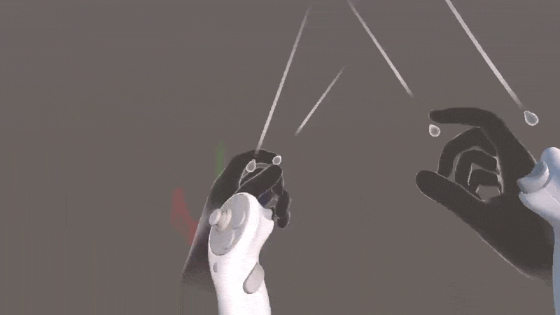
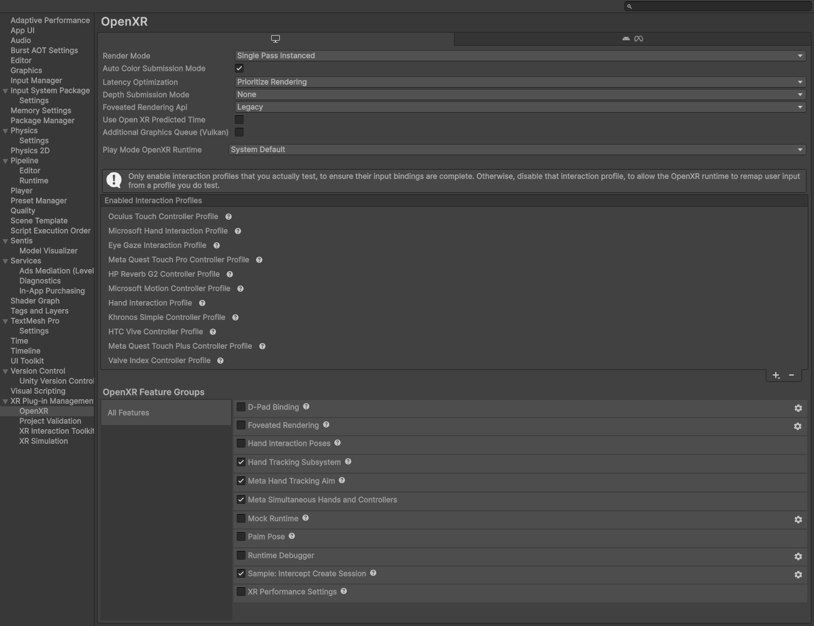
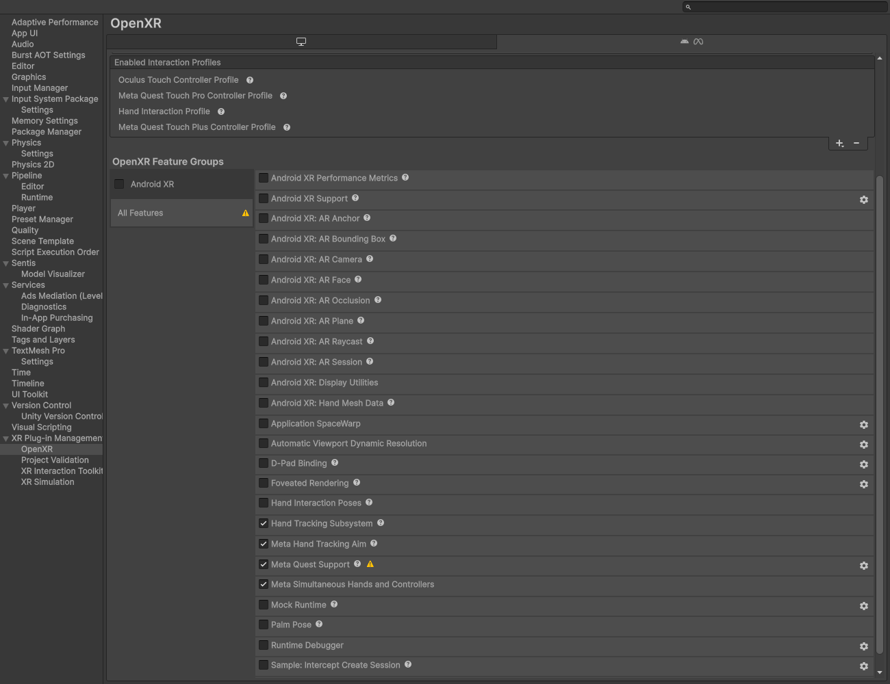
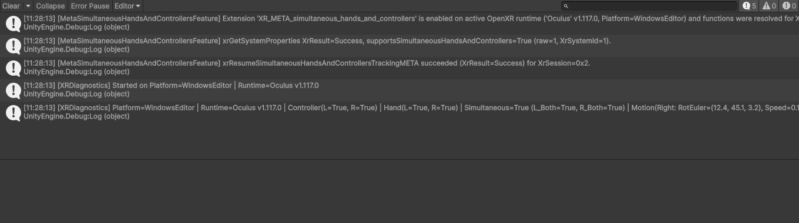

# Unity OpenXR Simultaneous Hands and Controllers (Multimodal)

[](LICENSE)
[](https://unity.com/)
[](#status)
[](#what-this-does-and-why)
[](#compatibility-table)

Enables **`XR_META_simultaneous_hands_and_controllers` (Multimodal Tracking)** in Unity using only the standard OpenXR stack (**Unity OpenXR Plugin**, **XR Hands**, and **XR Interaction Toolkit (XRI)**)—**no Meta XR Core SDK, no Oculus Integration package required**.

Allows tracking **both hands and physical controllers at the same time** on Meta Quest headsets, supporting both **Windows Editor / PCVR (via Meta Quest Link)** and **Android (standalone Meta Quest APK builds)**.



*Live demonstration of simultaneous hands and controllers (multimodal tracking) in Unity OpenXR: tracked hand skeletons and controller models move and update independently in real time.*

---

## Key Features

- **Simultaneous Hands & Controllers (Multimodal):** Enables `XR_META_simultaneous_hands_and_controllers` through an `OpenXRFeature` without importing the heavy Meta SDK or Oculus Integration assets.
- **Pure Unity OpenXR Stack:** Fully compatible with **Unity OpenXR Plugin** (`1.16.1`+), **XR Hands** (`1.7.3`+), and **XR Interaction Toolkit** (`3.3.2`+).
- **Dual Platform Support:** Configured for **Windows Editor / Standalone** (via Meta Quest Link / Air Link) and **Android** (Meta Quest 3, Quest 3S, Quest Pro, and Quest 2 standalone builds).
- **Controller Pose Isolation:** Prevents physical Touch controller visuals from snapping to tracked hands when a controller is set down on a desk or held passively.
- **Controller Motion & IMU Data:** Component (`ControllerMotionData`) providing real-time controller rotation, forward vector, linear velocity, angular velocity, speed, and tracking confidence.
- **3D Object Motion Mapper & Status Display:** Component (`ControllerMotionObjectMapper`) to map controller rotation to 3D objects, display live `MOVING` vs `STATIC` status on **TextMeshPro**, and provide a one-click `Recenter()` function.
- **Automated Editor Setup:** One-click menu utilities (`Tools > OpenXR Multimodal`) to automatically configure OpenXR settings, import required package samples, and convert existing scene rigs for simultaneous tracking.

---

## Status

> **Experimental, pending device verification.**
> - **Platform Support:** Supports Windows Editor / Standalone (via Meta Quest Link) and Android (Meta Quest).
> - **What is proven:** All runtime, editor, and diagnostic scripts compile with zero errors on Unity `6000.3.12f1` against `com.unity.xr.openxr@1.16.1`, `com.unity.xr.hands@1.7.3`, `com.unity.xr.interaction.toolkit@3.3.2`, and `com.unity.inputsystem@1.19.0`. All OpenXR structure layouts and function signatures are verified directly against Unity's installed OpenXR headers.
> - **What is NOT yet proven:** No test on a physical Meta Quest headset or over Meta Quest Link is claimed in this repository yet; compatibility rows below remain `Not yet tested` until device verification is recorded.

---

## What This Does and Why

### The Problem in Unity's Default OpenXR Stack

1. **Unity's OpenXR packages do not request the extension:** While `com.unity.xr.openxr` defines the structure constants (`1000532001`, `1000532002`, `1000532003`) in `XrStructureType.cs` and native C definitions in `openxr_reflection_full.h`, no built-in OpenXR feature requests `XR_META_simultaneous_hands_and_controllers` or calls `xrResumeSimultaneousHandsAndControllersTrackingMETA`.
2. **`XRInputModalityManager` disables hands when a controller is active:** In `com.unity.xr.interaction.toolkit` (`3.3.2`), `XRInputModalityManager` deactivates the hand GameObject hierarchy whenever a controller is tracked on that side, preventing both from rendering simultaneously.
3. **Default XRI controller bindings fall back to tracked hands:** `XRI Left/Position` and `XRI Right/Position` include `<XRHandDevice>/devicePosition` as a fallback, and `HandCommonPosesInteraction` marks controller `devicePose`/`pointer` actions as `isAdditive = true`. This causes a set-down controller visual to jump into the center of your tracked hand unless isolated.

### What This Repository Provides

- **`MetaSimultaneousHandsAndControllersFeature` (`OpenXRFeature`):** Requests `XR_META_simultaneous_hands_and_controllers` on both `BuildTargetGroup.Android` and `BuildTargetGroup.Standalone`, queries system support via `xrGetSystemProperties`, and calls `xrResumeSimultaneousHandsAndControllersTrackingMETA` when the session begins. Fails safely with a single warning if unsupported.
- **`SimultaneousHandsAndControllersStatus`:** Runtime component exposing `IsExtensionEnabled`, `SystemReportsSupport`, and `ResumeSucceeded`.
- **`ControllerMotionData`:** Runtime component exposing controller `rotation`, `forward`, `linearVelocity`, `angularVelocity`, `speed`, `trackingState`, `isTracked`, and `isVelocityValid`.
- **`ControllerMotionObjectMapper`:** Maps controller rotation to any 3D object, calculates motion thresholds (`MOVING` vs `STATIC`) displayed on **TextMeshPro**, and provides a `Recenter()` function with controller button / keyboard shortcut support.
- **`ControllerPoseIsolation`:** Runtime component that isolates controller `TrackedPoseDriver` bindings to `<XRControllerWithRumble>` and locks the 3D controller visual at its last tracked pose when set down.
- **`MultimodalSetupUtility` (Editor):** Automatically configures OpenXR Plug-in Management and OpenXR Feature Settings for both **Standalone (Windows, Mac, Linux)** and **Android**, imports required XRI / XR Hands samples if missing, and provides **Tools > OpenXR Multimodal** menu commands.
- **`XRSimultaneousTrackingDiagnostics` (Sample):** Logs platform, active OpenXR runtime name/version, hand and controller tracked states, simultaneous flag, and controller motion once per second.

---

## Quick Install

### Option A: Download `.unitypackage` (Includes Demo Scene & Configured XR Rig Prefab)

1. Download **`OpenXR-Simultaneous-Hands-and-Controllers-v0.1.0-experimental.unitypackage`** from [**GitHub Releases**](https://github.com/HussienX123/Unity-OpenXR-Simultaneous-Hands-and-Controllers-Multimodal/releases/tag/v0.1.0-experimental).
2. In your Unity project (with `com.unity.xr.openxr` and `com.unity.xr.interaction.toolkit` installed), select **Assets > Import Package > Custom Package...** and import the `.unitypackage`.
3. On import, `MultimodalSetupUtility` automatically:
   - Installs `com.unity.xr.hands` (if not already installed) and imports the required XRI / XR Hands samples (`Starter Assets`, `Hands Interaction Demo`, `HandVisualizer`).
   - Enables `Meta Simultaneous Hands and Controllers`, `Hand Tracking Subsystem`, `Meta Hand Tracking Aim`, `Hand Interaction Profile`, and `Touch / Touch Pro / Touch Plus` controller profiles on both **Standalone** and **Android**, and disables **`Hand Interaction Poses`**.
4. Open **`Assets/Scenes/MultimodalTest.unity`** (or click **Tools > OpenXR Multimodal > 4. Open Multimodal Demo Scene**).

### Option B: Install via Package Manager (Git URL)

In Unity **Window > Package Management > Package Manager**, click **+ > Add package from git URL...** and enter:

```text
https://github.com/HussienX123/Unity-OpenXR-Simultaneous-Hands-and-Controllers-Multimodal.git?path=/Packages/com.hussienx.openxr-simultaneous-hands-controllers
```

---

## Setup & Configuration

### A. Windows Editor / Standalone (via Meta Quest Link)

1. Open **Edit > Project Settings > XR Plug-in Management** and select the **Windows, Mac, Linux** tab. Enable **Initialize XR on Startup** and check **OpenXR**.
2. Open **Edit > Project Settings > XR Plug-in Management > OpenXR** (Windows, Mac, Linux tab) and set **Play Mode OpenXR Runtime** to **Oculus** (or **System Default** if Meta Quest Link is the Windows active OpenXR runtime). *Note: Unity stores this dropdown in `SessionState` and resets it to **System Default** on Editor restart.*
3. Under **OpenXR Feature Groups** (Windows, Mac, Linux tab), enable **Meta Simultaneous Hands and Controllers**, **Hand Tracking Subsystem**, and **Meta Hand Tracking Aim**.
4. Under **Enabled Interaction Profiles** (Windows, Mac, Linux tab), enable **Hand Interaction Profile** and **Oculus Touch Controller Profile** (plus **Meta Quest Touch Pro / Plus** profiles if used). Leave **Hand Interaction Poses** (`HandCommonPosesInteraction`) **disabled**.



### B. Android (Meta Quest Standalone Build)

1. Open **Edit > Project Settings > XR Plug-in Management** and select the **Android** tab. Enable **Initialize XR on Startup** and check **OpenXR**.
2. Open **Edit > Project Settings > XR Plug-in Management > OpenXR** (Android tab) and enable **Meta Quest Support**, **Meta Simultaneous Hands and Controllers**, **Hand Tracking Subsystem**, and **Meta Hand Tracking Aim**.
3. Under **Enabled Interaction Profiles** (Android tab), enable **Hand Interaction Profile**, **Oculus Touch Controller Profile**, **Meta Quest Touch Pro Controller Profile**, and **Meta Quest Touch Plus Controller Profile**. Leave **Hand Interaction Poses** (`HandCommonPosesInteraction`) **disabled**.
4. Build and run on the headset (`IL2CPP`, `ARM64`, Minimum API Level `29`+).



### C. Scene Setup for Simultaneous Tracking

1. On your scene's `XR Origin`, remove or disable **`XRInputModalityManager`** so both `Left/Right Hand` and `Left/Right Controller` hierarchies remain active together (pre-configured in `Assets/Prefabs/XR/XR Origin Hands (XR Rig).prefab` and `Assets/Scenes/MultimodalTest.unity`).
2. Add `ControllerPoseIsolation` to both `Left Controller` and `Right Controller` GameObjects to isolate bindings to physical motion controllers and prevent fallback snapping.
3. (Optional) Use menu **Tools > OpenXR Multimodal > 3. Convert Active Scene XR Rig for Simultaneous Tracking** to perform this setup automatically in any active scene.

---

## Controller Motion Mapping & TextMeshPro Status

Use [`ControllerMotionObjectMapper`](file:///e:/Unity%20New%20Projects/Flyline_IMU/Assets/Scripts/XR/ControllerMotionObjectMapper.cs) to map rotation data from the controller onto any 3D GameObject (e.g. flight stick, tool, weapon, or visual model) with a live **TextMeshPro** motion state HUD:

- **Live Status:** Displays `<color=#4CAF50><b>Status: MOVING</b></color>` or `<color=#FFD54F><b>Status: STATIC</b></color>` based on linear and angular thresholds.
- **Recenter:** Resets the 3D object rotation and adds subsequent controller rotation relative to the new reference pose. Trigger via UI Button, controller button, keyboard (<kbd>R</kbd>), or Inspector button.
- **1-Click Creation:** Select **Tools > OpenXR Multimodal > 5. Create Motion Mapped 3D Object (Cube + TMP)** to spawn a pre-configured test rig.

---

## Expected Log Output

### 1. Supported (Extension Enabled, System Supported, and Session Resumed)

```text
[MetaSimultaneousHandsAndControllersFeature] Extension 'XR_META_simultaneous_hands_and_controllers' is enabled on active OpenXR runtime ('Oculus' v1.117.0, Platform=WindowsEditor) and functions were resolved for XrInstance=0x1.
[MetaSimultaneousHandsAndControllersFeature] xrGetSystemProperties XrResult=Success, supportsSimultaneousHandsAndControllers=True (raw=1, XrSystemId=1).
[MetaSimultaneousHandsAndControllersFeature] xrResumeSimultaneousHandsAndControllersTrackingMETA succeeded (XrResult=Success) for XrSession=0x2.
[XRDiagnostics] Started on Platform=WindowsEditor | Runtime=Oculus v1.117.0
[XRDiagnostics] Platform=WindowsEditor | Runtime=Oculus v1.117.0 | Controller(L=True, R=True) | Hand(L=True, R=True) | Simultaneous=True (L_Both=True, R_Both=True) | Motion(Right: RotEuler=(12.4, 45.1, 3.2), Speed=0.142 m/s, VelocityValid=True)
```

### 2. Runtime Refused (`supportsSimultaneousHandsAndControllers == 0` or Extension Not Offered)

```text
[MetaSimultaneousHandsAndControllersFeature] OpenXR extension 'XR_META_simultaneous_hands_and_controllers' is not enabled or not supported by the active OpenXR runtime ('<runtime>' v<version>, Platform=<platform>). Simultaneous hand and controller tracking will remain inactive.
```

or if the extension is enabled but `xrGetSystemProperties` reports `supportsSimultaneousHandsAndControllers = 0`:

```text
[MetaSimultaneousHandsAndControllersFeature] xrGetSystemProperties XrResult=Success, supportsSimultaneousHandsAndControllers=False (raw=0, XrSystemId=<systemId>).
[MetaSimultaneousHandsAndControllersFeature] Active OpenXR runtime ('<runtime>' v<version>, Platform=<platform>) reported that simultaneous hands and controllers tracking is not supported (XrResult=Success, supportsSimultaneousHandsAndControllers=0).
```

### 3. Feature Not Enabled in OpenXR Settings

No `[MetaSimultaneousHandsAndControllersFeature]` log lines are emitted, and `[XRDiagnostics]` logs:

```text
[XRDiagnostics] Started on Platform=<platform> | Runtime=<runtime> v<version>
[XRDiagnostics] Platform=<platform> | Runtime=<runtime> v<version> | Controller(L=False, R=True) | Hand(L=False, R=False) | Simultaneous=False (L_Both=False, R_Both=False) | Motion(...)
```



---

## Compatibility Table

| Target / Device / Unity Version | Status | Notes |
| :--- | :--- | :--- |
| **Unity `6000.3.12f1`** | **Compiles** | Zero compiler errors across runtime, editor, and sample assemblies |
| **Editor (Windows) via Quest Link** | Not yet tested | PC OpenXR runtime support for `XR_META_simultaneous_hands_and_controllers` is **UNVERIFIED** |
| **Android build on Quest** | Not yet tested | Standalone APK on Meta Quest |
| **Meta Quest 3** | Not yet tested | Hardware multimodal supported by Meta OS |
| **Meta Quest 3S** | Not yet tested | Hardware multimodal supported by Meta OS |
| **Meta Quest Pro** | Not yet tested | Hardware multimodal supported by Meta OS |
| **Meta Quest 2** | Not yet tested | Pending device verification |
| **Unity `6000.0` LTS** | Not yet tested | Minimum declared `unity` version in `package.json` |

---

## Known Limitations and UNVERIFIED Items

- **PC OpenXR Runtime Support (UNVERIFIED):** Unity's installed OpenXR packages do not state whether the Meta Quest Link PC OpenXR runtime advertises `XR_META_simultaneous_hands_and_controllers` on Windows. If Play Mode over Link logs that the extension is not enabled or not supported, it can be a PC runtime limitation; an Android build on the headset is the definitive test.
- **Meta Quest Link App Menu Names (UNVERIFIED):** Exact menu paths and toggle names in the Meta Quest Link desktop application are not present in Unity's installed package files. Check Meta's official Quest Link documentation.
- **Android Manifest Requirements for `XR_META_simultaneous_hands_and_controllers` (UNVERIFIED):** `com.unity.xr.hands` documents `<uses-permission android:name="com.oculus.permission.HAND_TRACKING" />` and `<uses-feature android:name="oculus.software.handtracking" android:required="false" />`, which `MetaHandTrackingAim` injects automatically on Android builds. Whether `XR_META_simultaneous_hands_and_controllers` requires any additional `<meta-data>` tag in `AndroidManifest.xml` is not specified in Unity's installed OpenXR files; consult Meta's OpenXR specification if the Android runtime refuses the extension.
- **Quest OS Version Requirements (UNVERIFIED):** Minimum Horizon OS / Quest system software version required for `XR_META_simultaneous_hands_and_controllers` is not specified in the installed Unity packages.

---

## Documentation

- [Installation Guide](docs/installation.md)
- [How It Works (with Mermaid Flow Diagram)](docs/how-it-works.md)
- [Troubleshooting](docs/troubleshooting.md)
- [Public API Reference](docs/api.md)

---

## FAQ

### Works on device but not in Editor?
When testing in the Unity Editor over Meta Quest Link, Unity runs against the **Windows PC OpenXR runtime**, not the headset's Android OpenXR runtime. PC runtime support for `XR_META_simultaneous_hands_and_controllers` is **UNVERIFIED** in Unity's installed OpenXR files. If the PC runtime does not advertise the extension, `MetaSimultaneousHandsAndControllersFeature` logs one warning and continues safely; build and run an Android APK on the headset for the definitive test.

### Why does the 3D controller visual jump into my hand when I put the controller down?
By default, `XRI Left/Position` and `XRI Right/Position` fall back to `<XRHandDevice>/devicePosition` (the wrist of your tracked hand) and `HandCommonPosesInteraction` marks Touch controller `devicePose`/`pointer` actions as `isAdditive = true`. Disable **Hand Interaction Poses** in OpenXR settings and keep `ControllerPoseIsolation` on the controller GameObjects so they only bind to `<XRControllerWithRumble>` and stay locked at their last valid tracked position when set down.

---

## Search & SEO Keywords

For developers searching for this capability:
`unity openxr simultaneous hands and controllers`, `meta quest multimodal openxr unity`, `XR_META_simultaneous_hands_and_controllers`, `unity hand tracking and controller at the same time`, `track hands and controllers simultaneously meta quest 3`, `unity xr hands xr interaction toolkit multimodal`, `meta quest touch pro touch plus multimodal openxr`, `quest link simultaneous hands controllers unity`, `multimodal vr without meta sdk`, `pure openxr multimodal tracking unity`, `unity controller imu velocity rotation tracking`, `physical prop controller tracking with finger tracking unity`, `hybrid hands and controllers unity vr`.

---

## License

Released under the [MIT License](LICENSE).

Not affiliated with or endorsed by Meta Platforms or Unity Technologies.
