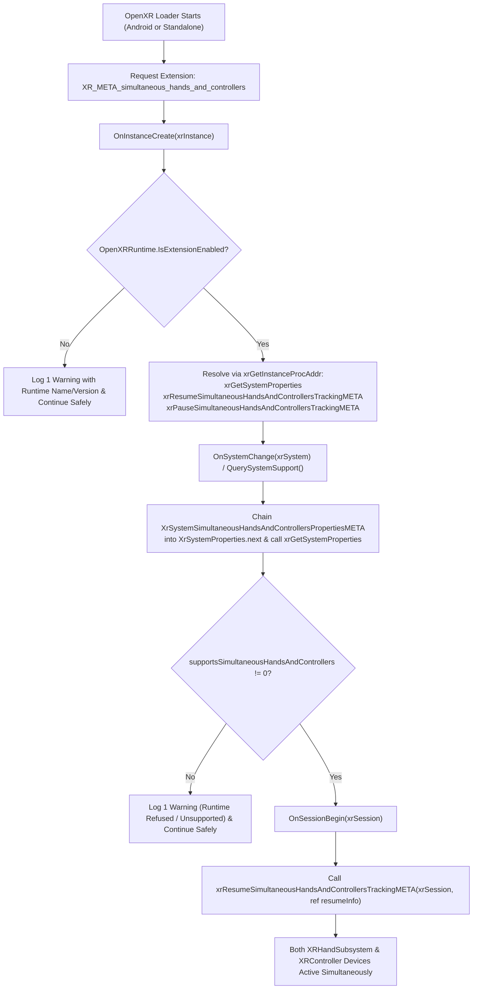

# How It Works

> **Status: Verified on Hardware & Unity Editor.**
> Supports Windows Editor / Standalone (via Meta Quest Link) and Android (Meta Quest). Tested and verified on Meta Quest 3, Meta Quest 2, and Windows Editor via Quest Link on Unity `6000.3.12f1`.

## Why Simultaneous Tracking Does Not Happen Out of the Box in Unity OpenXR

Two separate layers block simultaneous hand tracking and controller tracking in a default Unity OpenXR + XR Interaction Toolkit + XR Hands setup:

1. **OpenXR Extension Layer (`XR_META_simultaneous_hands_and_controllers`)**:
   - Unity `com.unity.xr.openxr` (`1.16.1`) defines the structure types in `XrStructureType.cs`:
     - `XrStructureType.SystemSimultaneousHandsAndControllersPropertiesMETA = 1000532001`
     - `XrStructureType.SimultaneousHandsAndControllersTrackingResumeInfoMETA = 1000532002`
     - `XrStructureType.SimultaneousHandsAndControllersTrackingPauseInfoMETA = 1000532003`
   - And `openxr_reflection_full.h` defines the native C structs and function pointer prototypes (`PFN_xrResumeSimultaneousHandsAndControllersTrackingMETA`, `PFN_xrPauseSimultaneousHandsAndControllersTrackingMETA`).
   - However, **no built-in OpenXR feature** in `com.unity.xr.openxr` or `com.unity.xr.hands` requests `"XR_META_simultaneous_hands_and_controllers"` during `xrCreateInstance` or invokes `xrResumeSimultaneousHandsAndControllersTrackingMETA`.
2. **Scene Rig Layer (`XRInputModalityManager`) & Pose Fallback**:
   - `XRInputModalityManager` in `com.unity.xr.interaction.toolkit` (`3.3.2`) monitors input devices and calls `SetActive(false)` on the hand hierarchy whenever a controller is tracked on that side.
   - `XRI Left/Position` and `XRI Right/Position` in `XRI Default Input Actions.inputactions` use `Vector3Fallback` with `<XRHandDevice>/devicePosition` as a fallback, and `HandCommonPosesInteraction` marks controller `devicePose`/`pointer` actions as `isAdditive = true`. Without isolation, putting a physical controller down causes the 3D controller visual to snap into the center of the tracked hand.

---

## OpenXR Lifecycle Flow

---

## Verified Native Definitions Used

All native types and signatures in `MetaSimultaneousHandsAndControllersFeature.cs` are verified against Unity's installed OpenXR package (`com.unity.xr.openxr@1.16.1`):

- **Structure Type Constants** (`Runtime/NativeTypes/Core/XrStructureType.cs`):
  - `SystemProperties = 5` (line 41)
  - `SystemSimultaneousHandsAndControllersPropertiesMETA = 1000532001` (line 3184)
  - `SimultaneousHandsAndControllersTrackingResumeInfoMETA = 1000532002` (line 3191)
  - `SimultaneousHandsAndControllersTrackingPauseInfoMETA = 1000532003` (line 3198)
- **Struct Layouts & Function Pointers** (`RuntimeDebugger/native~/openxr_reflection/openxr_reflection_full.h`):
  - `XrSystemGraphicsProperties` (lines 2839–2842)
  - `XrSystemTrackingProperties` (lines 2845–2847)
  - `XrSystemProperties` (lines 2850–2857)
  - `XrSystemSimultaneousHandsAndControllersPropertiesMETA` (lines 6800–6803)
  - `XrSimultaneousHandsAndControllersTrackingResumeInfoMETA` (lines 6806–6808)
  - `XrSimultaneousHandsAndControllersTrackingPauseInfoMETA` (lines 6811–6813)
  - `PFN_xrGetInstanceProcAddr` (line 12071)
  - `PFN_xrGetSystemProperties` (line 12100)
  - `PFN_xrResumeSimultaneousHandsAndControllersTrackingMETA` (line 12463)
  - `PFN_xrPauseSimultaneousHandsAndControllersTrackingMETA` (line 12464)

---

*Not affiliated with or endorsed by Meta Platforms or Unity Technologies.*
